## 🧩 Sprint 1 – Tarefa 2: Diagrama de Classes (UML)

Diagrama construído a partir dos cartões CRC acima: o que a classe **conhece** virou atributo, o que ela **faz** virou método e os **colaboradores** viraram os relacionamentos entre as classes.

```mermaid
classDiagram
    direction LR

    class Cidade {
        -nome: String
        -codigo: String
        +Cidade(nome: String, codigo: String)
        +getNome() String
        +getCodigo() String
    }

    class Rota {
        -codigo: String
        -origem: Cidade
        -destino: Cidade
        +Rota(codigo: String, origem: Cidade, destino: Cidade)
        +getCodigo() String
        +getOrigem() Cidade
        +getDestino() Cidade
    }

    class Voo {
        -CAPACIDADE_MAXIMA: int = 150$
        -rota: Rota
        -data: LocalDate
        -precoBase: double
        -lugaresOcupados: int
        +Voo(rota: Rota, data: LocalDate, precoBase: double)
        +getRota() Rota
        +getData() LocalDate
        +getPrecoBase() double
        +getLugaresDisponiveis() int
        +temLugarDisponivel() boolean
        +ocuparLugar() boolean
    }

    class Bilhete {
        -voos: List~Voo~
        +Bilhete(primeiroVoo: Voo)
        +adicionarVoo(voo: Voo) boolean
        -validarSequencia(novoVoo: Voo) boolean
        +calcularPreco() double
        +getOrigem() Cidade
        +getDestino() Cidade
        +getVoos() List~Voo~
    }

    class Cliente {
        -nome: String
        -sobrenome: String
        -numeroRegistro: String
        -bilhetes: List~Bilhete~
        +Cliente(nome: String, sobrenome: String, numeroRegistro: String)
        +getNome() String
        +getSobrenome() String
        +getNumeroRegistro() String
        +adicionarBilhete(bilhete: Bilhete) void
        +calcularTotalGasto() double
        +gerarRelatorio() String
    }

    class Agencia {
        -TAXA_COMISSAO: double = 0.06$
        -clientes: List~Cliente~
        -voos: List~Voo~
        -bilhetesVendidos: List~Bilhete~
        +cadastrarCliente(cliente: Cliente) void
        +cadastrarVoo(voo: Voo) void
        +buscarBilhetes(origem: Cidade, destino: Cidade, data: LocalDate) List~Bilhete~
        +venderBilhete(cliente: Cliente, bilhete: Bilhete) boolean
        +relatorioCliente(cliente: Cliente) String
        +relatorioPorOrigem(origem: Cidade) String
        +calcularArrecadacao() double
        +calcularComissao() double
    }

    Rota "*" --> "1" Cidade : origem
    Rota "*" --> "1" Cidade : destino
    Voo "*" --> "1" Rota : segue
    Bilhete "*" o-- "1..*" Voo : contém
    Cliente "1" o-- "*" Bilhete : compra
    Agencia "1" o-- "*" Cliente : cadastra
    Agencia "1" o-- "*" Voo : oferece
    Agencia "1" o-- "*" Bilhete : vende
```

### Legenda

| Símbolo | Significado |
|---|---|
| `-` | atributo/método privado |
| `+` | atributo/método público |
| sublinhado | atributo estático (constante da classe) |
| `-->` | associação (a classe da esquerda conhece a da direita) |
| `o--` | agregação (o losango fica no "todo"; as partes existem sozinhas) |
| `1`, `*`, `1..*` | multiplicidade: exatamente um, zero ou mais, um ou mais |
